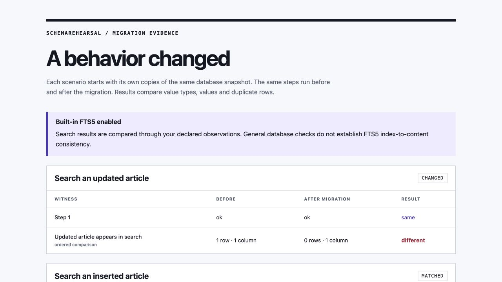

# SchemaRehearsal

**Find application behavior changes that a successful SQLite migration can hide.**

A table rebuild can preserve every row and pass database integrity checks while dropping an audit trigger or breaking search maintenance. SchemaRehearsal runs your declared workloads on independent before/after copies and reports what changed. It never applies a migration to your selected source database.



The [full-text search walkthrough](docs/full-text-search.md) reproduces this report with synthetic data. Audit, transaction and checkpoint examples are included too.

[](pyproject.toml) [](docs/design.md) [](LICENSE)

Python 3.11 or later. No runtime dependencies, account, network connection, or database server. The [release](https://github.com/nazeeh111/SchemaRehearsal/releases/latest) includes a wheel for offline installation with `python -m pip install --no-index --no-deps schema_rehearsal-0.4.0-py3-none-any.whl`. Or install from this source checkout:

```sh
python -m venv .venv
. .venv/bin/activate
python -m pip install .
schema-rehearsal --version
```

## Try a migration that loses an audit trail

```sh
schema-rehearsal example example
schema-rehearsal check --database example/orders.sqlite \
  --migration example/broken.sql --suite example/suite.json --output broken-report
# Exit 1: the payment workflow changes.

schema-rehearsal check --database example/orders.sqlite \
  --migration example/repaired.sql --suite example/suite.json --output repaired-report
# Exit 0: declared behaviors match.
```

Open `broken-report/report.html` in your browser, or read `report.json` in CI. Every output directory must be new; existing files are never replaced. The example command also requires a new directory, with an existing parent. An error can leave a partial new directory for inspection; choose a new path for a retry.

The original synthetic fixture has 20 accounts and 200 orders. Both migrations keep those rows and pass integrity and foreign-key checks. Paying 17 orders produces 17 audit records before migration, **zero** after the broken migration, and 17 after the repaired one. A second scenario checks an exact constraint failure; a third demonstrates that scenarios start independently. No production database is included.

## Catch a regression that a later migration repairs

A final-state check can match while an earlier migration checkpoint breaks a
workflow. `sequence` applies explicitly ordered migrations on a single cumulative
copy and runs the same suite after each committed checkpoint. Every checkpoint
compares with **one frozen starting snapshot**, even if another writer changes
the source during the rehearsal.

```sh
schema-rehearsal sequence --database app.sqlite --suite suite.json \
  --migration 001.sql --migration 002.sql --migration 003.sql \
  --output sequence-report
```

The [runnable sequence example](docs/sequences.md) demonstrates a middle migration
that loses an audit trigger and a final migration that restores it. Checking only
the final state returns `matched`; the sequence returns exit 1, with checkpoint
results `matched → changed → matched` and `first_changed: 2`. Its self-contained
HTML report lets you inspect each checkpoint's witnesses and schema differences.

Changes keep the aggregate result `changed` even after repair. Execution errors
and invalid baselines stop the sequence and mark later checkpoints `not_run`;
their exits 2 or 3 take precedence over a previously observed change. `first_changed`
is the earliest observed difference, not a causal proof. Reports use ordinal
checkpoint numbers and input hashes, omitting migration filenames and SQL.

Up to eight migrations, 1 MiB of combined migration SQL and one shared 30-second
cooperative budget are supported. Each file must end outside a transaction;
transactions cannot span files. Foreign-key enforcement and recursive triggers
are restored after each checkpoint, so a later migration needing foreign keys
disabled must explicitly disable them. The same workloads must be valid against
the starting schema and relevant checkpoints. New application versions,
concurrent deployments and migration-runner bookkeeping are not modeled.

## Keep search working after a migration

Built-in SQLite FTS5 support is explicit: use `--allow-fts5` with `check` or
`sequence`. Declared writes exercise index maintenance; read-only `MATCH`
observations compare search behavior. A consistent index can still return
different results after a tokenizer change.

```sh
schema-rehearsal example --fts5 search-example
schema-rehearsal check --allow-fts5 \
  --database search-example/articles.sqlite \
  --migration search-example/broken.sql \
  --suite search-example/suite.json --output search-report
# Exit 1: article rows remain, but an update stops reaching search.
```

The [full-text search walkthrough](docs/full-text-search.md) includes repaired,
tokenizer and checkpoint examples. SQLite's built-in full FTS5 consistency check
already detects index/content mismatch. This extension adds existing rehearsal
orchestration and declared search comparisons; general database checks are not
an FTS5 consistency certification. Other virtual-table modules remain refused.

## Describe the behavior you depend on

The [runnable walkthrough](docs/walkthrough.md) demonstrates how to ignore row
order without missing changed duplicates, then shows how to extend a workload.

A suite is a JSON file. Each named scenario has mutation `steps`, followed by read-only `observations`:

```json
{
  "format": "schema-rehearsal/v1",
  "scenarios": [{
    "name": "Pay an order",
    "steps": [{
      "sql": "UPDATE orders SET status=? WHERE id=?",
      "parameters": ["paid", 1]
    }],
    "observations": [{
      "name": "Audit coverage",
      "sql": "SELECT order_id, new_status FROM audit ORDER BY order_id",
      "order": "ordered"
    }]
  }]
}
```

Each step is one SQL statement; triggers run normally. Bound parameters support null, strings, signed 64-bit integers and finite real numbers. A step can declare `"expect_error": "SQLITE_CONSTRAINT_CHECK"` or another exact SQLite constraint code. If the baseline does not meet that expectation, the baseline is invalid. A different constraint outcome after migration is a behavior change. Other SQLite execution failures are errors, with their raw messages withheld.

Observations compare SQLite value types and values. Integer `1`, real `1.0`, text `"1"`, null and a BLOB are distinct. `ordered` is the default: provide an `ORDER BY` that makes your intended order deterministic. `multiset` ignores row order but preserves duplicate multiplicity. Column count is compared; result-column labels are not. Step result rows are consumed and bounded, but only their success/constraint outcomes are compared; use observations for values you want checked.

The migration file supports multiple statements, quoted semicolons, trigger bodies and explicit transactions. It must finish with no open transaction. Scenario steps run in autocommit mode by default. Add `"transaction": "commit"` to a scenario to commit its steps together, and optionally `"expect_commit_error": "SQLITE_CONSTRAINT_FOREIGNKEY"` to expect an exact commit constraint failure. A failed commit rolls back before observations. If SQLite rolls back implicitly, later steps are `not_run` and commit is `not_attempted`; that baseline is invalid, or a migrated difference is changed. See the [runnable transaction walkthrough](docs/transactions.md).

Scenario SQL cannot control transactions, use savepoints or modify schema. Observations cannot mutate the database. Every scenario starts from fresh copies, not the preceding scenario's result.

## What the result means

| Exit | Status | Meaning |
| --- | --- | --- |
| 0 | `matched` | All declared behaviors match. |
| 1 | `changed` | At least one step, commit outcome or observation changed. |
| 2 | `error` | Invalid input, unsupported operation, migration failure, limit, or other execution/output error. |
| 3 | `invalid_baseline` | Baseline database checks or a baseline scenario failed. |

Reports keep the engine version, input hashes, copied-snapshot hash, database checks, schema-object changes, scenario outcomes and result shapes. They omit SQL, parameters, raw result cells, database paths, snapshots and raw SQLite errors. **Scenario names, observation names, schema names and row counts remain visible metadata.** Do not put secrets in those names. Hashes are evidence of equality, not anonymization. Retain inputs privately to reproduce a result.

A changed scalar observation can show one row before and after: its hidden cell changed, not its shape. To investigate, find the named observation in your private suite and reproduce its steps and query on your own disposable before/after copies. The report deliberately does not disclose those values.

This tool tests declared behaviors, not all possible application behavior. It does not generate or apply production migrations, certify migration safety, measure production performance, or model concurrent application writers.

## Boundaries

The source opens with SQLite `mode=ro`. SQLite's backup API captures committed WAL data into a private in-memory snapshot; simply copying the main database file would miss it. SQL writes run only on copies. SQLite may create or update coordination sidecars such as `-shm`, and another writer may change the source concurrently. We do not promise that the whole source directory stays byte-for-byte identical. Use a selected database you are permitted to read, and retain your normal backups.

Default limits: 64 MiB per database copy and source sidecar, 1 MiB per input file, 32 scenarios, 64 steps and 16 observations per scenario, 10,000 rows and 2 MiB encoded result data per statement, and a 30-second cooperative execution deadline. Result bounds apply to migration and step results too. Copies coexist, so these are workload bounds, not a hard total process-memory or operating-system sandbox. A single SQLite call or OS operation can delay cooperative interruption.

External attachment, extension loading, virtual tables by default, explicit TEMP objects, file-writing SQL, unsafe pragmas and common time/random functions are blocked. Migrations may set only `foreign_keys`, `defer_foreign_keys` and `user_version`; selected metadata pragmas are readable. Foreign-key enforcement and recursive triggers are enabled for scenarios. Only built-in FTS5 is available with explicit opt-in; your SQLite build must include it. Custom collations/functions, encrypted databases and other virtual-table modules are unsupported. A workload requiring blocked date/time functions needs fixed values supplied as parameters. See [design and tradeoffs](docs/design.md).

## Development

```sh
PYTHONPATH=src python -m unittest discover -s tests -v
python -m compileall -q src
```

CI is configured to run tests on Linux with Python 3.11 and 3.14, build a wheel and run the installed CLI outside the source tree. See [verification](docs/verification.md) for actual recorded results and remaining limits.

Original software under the [MIT license](LICENSE). Migration testing is an established technique; this project focuses on a small, local SQLite workflow and explicit behavioral evidence.
