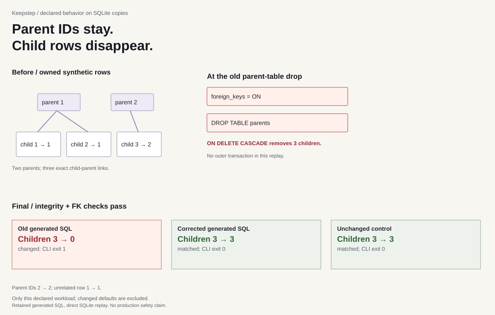

# Parent IDs stay. Child rows disappear.

Keepstep runs a declared workload on independent SQLite before/after copies. This example applies the repository's retained Drizzle-generated SQL directly to a newly created synthetic database. It does not touch a user's database, run an ORM or deployment, or certify migration safety.

## The exact lost relationships

The fixture has parent IDs 1 and 2, child links `(1,1)`, `(2,1)` and `(3,2)`, and one unrelated row. In the old generated migration, rebuilding the unrelated table re-enables foreign keys. The later `DROP TABLE parents` therefore runs with enforcement on; `ON DELETE CASCADE` removes all children. The copied parent table is renamed back, leaving both parent IDs present and no orphaned rows. Integrity and foreign-key checks pass.

The declared observation compares the child identities and parent links. It changes from 3 rows to 0, so Keepstep correctly returns **exit 1 / changed**. Parent identities 2→2 and unrelated row 1→1 are negative controls. Corrected generated SQL and an unchanged control both retain 3 children and return **exit 0 / matched**. The intentional default changes are outside this suite's observations; matched is not a statement that every aspect of the schema or application is identical.

<picture><source media="(max-width: 600px)" srcset="children-mobile.svg"></picture>

The relationship diagram is a schematic of the fixture's actual IDs, not a physical plot. All three links are retained. The drop-point states come from [the direct SQLite trace](sqlite-trace.json), with explicit autocommit and no outer transaction. An implicit Python transaction would change when PRAGMA foreign_keys can take effect; it is not silently substituted for the documented case.

## Run the real comparison

From a source checkout, no package, database server, Node or account is required:

```sh
python3 examples/drizzle-table-rebuild/run.py NEW-output-directory
```

The wrapper creates its own disposable fixture, runs the real CLI three times, independently inspects the resulting rows and asserts the expected outcomes. **The wrapper returns 0 when it reproduces expected CLI exits 1/0/0.** That is a demonstration assertion, not a production gate that accepts behavior changes. For application CI, preserve every nonzero `check` or `sequence` exit as failure. [Precise CI guidance](../continuous-integration.md).

[Open the changed report](records/old/report.html) · [corrected control](records/fixed/report.html) · [unchanged control](records/unchanged/report.html) · [actual summary and synthetic local rows](summary.json) · [complete portable replay](worked-example.zip).

The underlying CLI call is:

```sh
schema-rehearsal check --database before.sqlite --migration old.sql --suite suite.json --output NEW-report-directory
# Exit 1 means changed. Exit 0 means the declared behavior matched.
```

General exits are 0 matched, 1 changed, 2 error and 3 invalid baseline. The existing-output refusal and invalid-suite control both return 2 without replacing an existing report. The generated fixture and six case input files remain byte-identical after all three checks. This controlled fixture preservation is not a promise that arbitrary SQLite coordination sidecars or concurrent source directories never change.

## Open the actual artifacts

[Desktop changed report](old-report-desktop.png) · [corrected report](fixed-report-desktop.png) · [phone before horizontal scroll](report-phone-before.png) · [phone after keyboard scroll](report-phone-after.png) · [actual browser checks](browser.json).

Native reports are self-contained, script-free HTML with no external requests. Focus a comparison table and use arrow keys to inspect all columns on a narrow screen; Enter expands reproduction and method evidence. Native report.json is the machine interface. There is no invented dashboard, database upload or added export button: these are the real CLI-produced HTML/JSON files. Freshly reopen the same files in a separate browser or extracted archive.

Normal reports deliberately omit SQL, bound parameters, source paths and raw cell values. The diagram and direct trace disclose only this explicitly public synthetic fixture; they do not imply the product exposes private application rows. Source/migration/suite hashes bind the captured case without anonymizing arbitrary private data. The native suite hash uses sorted compact JSON; summary.json separately retains the raw six input-file byte hashes.

## Attribution and execution conditions

The case comes from [kholdrex's issue #6621](https://github.com/drizzle-team/drizzle-orm/issues/6621), closed as a duplicate of [issue #5469](https://github.com/drizzle-team/drizzle-orm/issues/5469). These primary reports were checked November 17, 2026. The existing case independently retained generated files from drizzle-kit 0.31.11/drizzle-orm 0.45.4 and corrected 1.0.0-rc.5. This pass **replayed those exact files**, without npm installs or regeneration. The reporter already identified the cause; this is not a newly discovered ORM defect or recommendation to upgrade to a release candidate. [Original detailed case and lockfile provenance](../../examples/drizzle-table-rebuild/README.md).

Actual execution uses CPython 3.14.7 and SQLite 3.50.4. The SQL is applied directly, outside an outer transaction. No Cloudflare D1, better-sqlite3, Drizzle migration runner, production app or concurrent writer was exercised. A changed result does not prove cause without inspecting the declared case; a matched result does not cover undeclared behavior.

## Portable replay and preserved identity

The archive contains matching current source, the six exact SQL/suite inputs, the existing fixture runner, native captured HTML/JSON and synthetic summary/database, MIT license, an archive-specific local guide and hash manifest. It creates its own new database and output. All report readers resolve, and a fresh extracted run reproduces the native reports under the recorded SQLite runtime. No runtime dependency is required beyond Python's SQLite module.

Keepstep is the display identity. `schema-rehearsal`, `schema_rehearsal` and the SchemaRehearsal repository/URLs remain compatible. See the full [design contract](../design.md), [input boundaries](../../README.md#boundaries), [FTS5 walkthrough](../full-text-search.md), [ordered checkpoints](../sequences.md), [transactions](../transactions.md), [verification](../verification.md) and[MIT license](../../LICENSE). Current-main maintenance changes are preserved; the separate engineering branch's report-readability changes are not overlaid.
